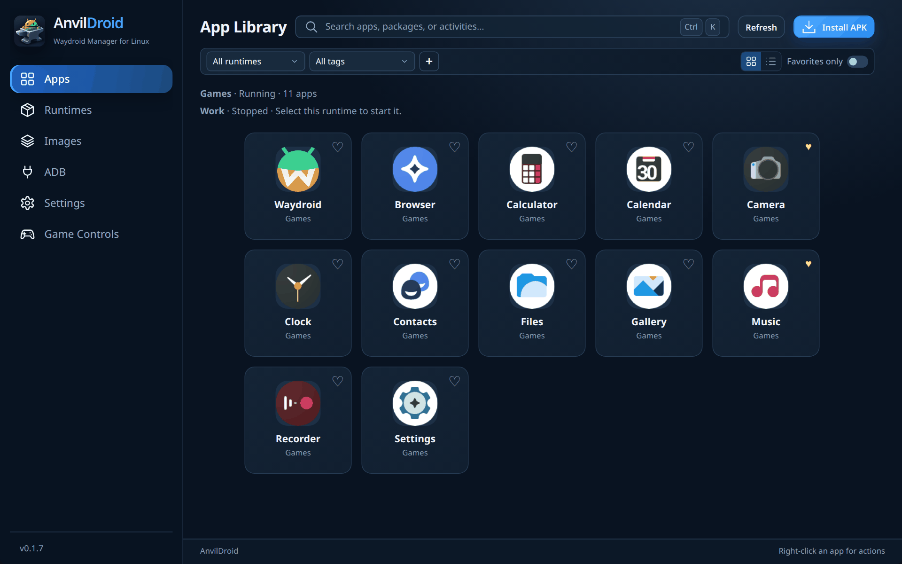
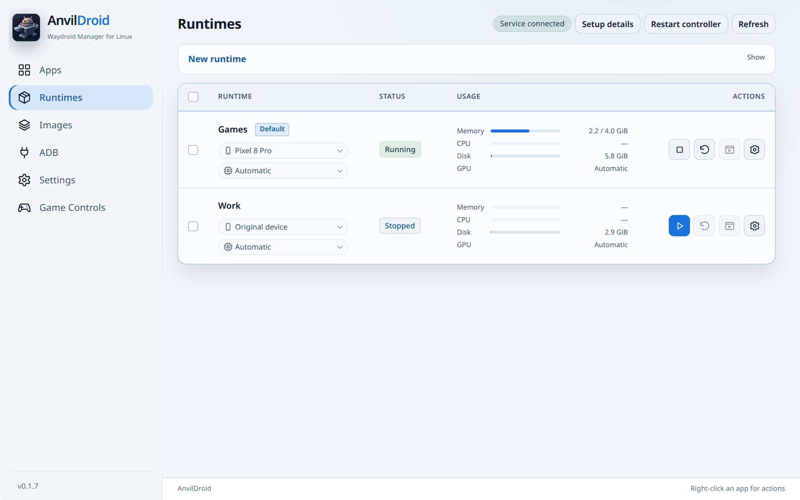
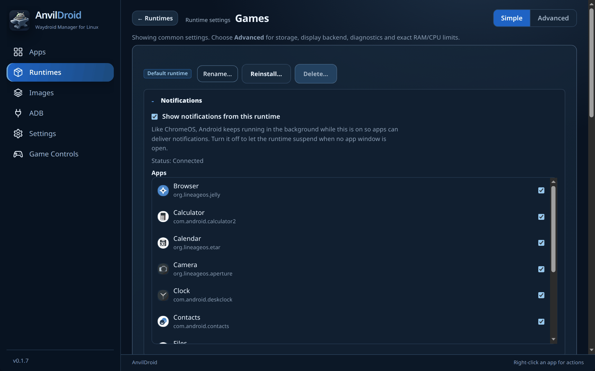

# AnvilDroid

[](https://github.com/collyn/anvildroid/releases/latest)
[](https://github.com/collyn/anvildroid/actions/workflows/release.yml)
[](LICENSE-MIT)

Run Android apps on the Linux desktop. AnvilDroid is a GUI and runtime
controller for [Waydroid](https://waydro.id): isolated Android runtimes, app
windows on Wayland and X11, desktop notifications, game controls and more.

> **Experimental, actively developed.** Linux x86_64 only.



<table>
  <tr>
    <td></td>
    <td></td>
  </tr>
  <tr>
    <td align="center">Runtimes with live usage and quick device/GPU switch</td>
    <td align="center">Runtime settings (Simple view), per-app notifications</td>
  </tr>
</table>

<sub>Screenshots show the built-in apps of a LineageOS-based Waydroid image.</sub>

## Install

**Debian, Ubuntu, Linux Mint**

```bash
curl -fsSL https://collyn.github.io/anvildroid/install.sh | sudo bash
```

**Fedora**

```bash
curl -fsSL https://collyn.github.io/anvildroid/install-fedora.sh | sudo bash
```

**openSUSE**

```bash
curl -fsSL https://collyn.github.io/anvildroid/install-opensuse.sh | sudo bash
```

**Arch Linux**

```bash
curl -fsSL https://collyn.github.io/anvildroid/install-arch.sh | sudo bash
```

**AppImage (any distribution):** download `AnvilDroid-<version>-x86_64.AppImage`
from the [latest release](https://github.com/collyn/anvildroid/releases/latest),
make it executable and run it. It installs the runtime controller on first use
(administrator approval required).

Single packages (`.deb`, `.rpm`, `.pkg.tar.zst`) are also attached to each
release.

### Requirements

- Linux x86_64 with a Wayland or X11 desktop session, glibc 2.39+ (Ubuntu 24.04 or newer)
- [Waydroid](https://docs.waydro.id/) installed (AnvilDroid can install the runtime tools for you)
- Intel or AMD GPU with Mesa; NVIDIA is experimental ([details](docs/TECHNICAL.md#compatibility-and-limitations))
- systemd and polkit

## Getting started

1. Open **AnvilDroid** from your applications menu.
2. **Images** → download an official Waydroid image (or import your own).
3. **Runtimes** → **New runtime** → pick the image → **Create**. AnvilDroid
   prepares the images and starts Android; this takes a few minutes the first time.
4. **Apps** → install an APK or open an app. Each app gets its own desktop window.

Runtime settings come in **Simple** and **Advanced** views. Change the device
identity or GPU right from the runtime list; a running runtime restarts to apply it.

## Updates

- **Settings → Updates** checks for new releases, installs the right package
  for your system after you confirm, and restarts AnvilDroid.
- Installed from the repositories above? Your normal system update
  (`apt upgrade`, `dnf upgrade`, `pacman -Syu`) also updates AnvilDroid.

## Features

- Multiple isolated Android runtimes running side by side, each with its own
  apps, data, storage location and RAM/CPU limits
- System Waydroid management alongside managed runtimes
- Android apps as native windows on Wayland and X11, plus the full Android UI
- Desktop notifications from Android apps, with per-app control
- Host input method (e.g. Fcitx), clipboard and shared folders
- Game controls: mouse-to-touch, key mapping, FPS mouse capture, macros and
  per-app control schemes (press **F2** in a game window)
- Official and custom images (folder, ZIP or URL; ext4, EROFS, SquashFS)
- ARM translation (libndk_translation, libhoudini), device identity profiles,
  Google Play registration help
- ADB for Android Studio, diagnostics export, light and dark themes

## Known limitations

- Official Android 13 Waydroid images are the most tested; newer and custom
  images are experimental.
- App and game compatibility depends on the image, ARM translator and GPU.
  Apps that require Play Integrity (banking, some games, DRM video) usually
  do not work.
- Full Android UI and separate app windows cannot be used at the same time in
  one runtime.

More: [compatibility and limitations](docs/TECHNICAL.md#compatibility-and-limitations).

## Documentation

- [Technical guide](docs/TECHNICAL.md): architecture diagrams, display and
  notification pipelines, building from source, releasing and development
- [Native X11 adapter](native/x11/README.md) · [NVIDIA payload](native/nvidia/README.md)

## Credits

AnvilDroid builds on [Waydroid](https://github.com/waydroid/waydroid),
the [Android Open Source Project](https://source.android.com/) and
[LineageOS](https://github.com/LineageOS),
[quinovax/waydroid-nvidia](https://github.com/quinovax/waydroid-nvidia),
[Mesa](https://gitlab.freedesktop.org/mesa/mesa),
[virglrenderer](https://gitlab.freedesktop.org/virgl/virglrenderer),
[ANGLE](https://github.com/google/angle),
[astc-encoder](https://github.com/ARM-software/astc-encoder),
[scrcpy](https://github.com/Genymobile/scrcpy), [Tauri](https://github.com/tauri-apps/tauri),
the [supremegamers](https://github.com/supremegamers) ARM translation
prebuilts and [Noto Fonts](https://github.com/notofonts/noto-fonts). Thank you
to their maintainers and contributors.

Third-party code, fonts, images and binaries keep their own licenses: see the
[NVIDIA notices](packaging/nvidia/NOTICE),
[NVIDIA component licenses](packaging/nvidia/LICENSE.upstream),
[ASTC decoder license](packaging/nvidia/LICENSE.astc-encoder) and
[font license](native/menu-font-OFL.txt). Bundled AOSP tool notices are
installed in `/usr/local/lib/anvildroid-controller/tools/NOTICE.txt`.

## License

AnvilDroid's source code is [MIT](LICENSE-MIT) licensed. Waydroid,
Android/LineageOS images, Google services, ARM translation packages and
installed apps remain under their own licenses. The ARM translators are
proprietary prebuilts downloaded separately; read the
[ARM translation licensing notes](docs/TECHNICAL.md#arm-translation-licensing)
before redistributing them.
