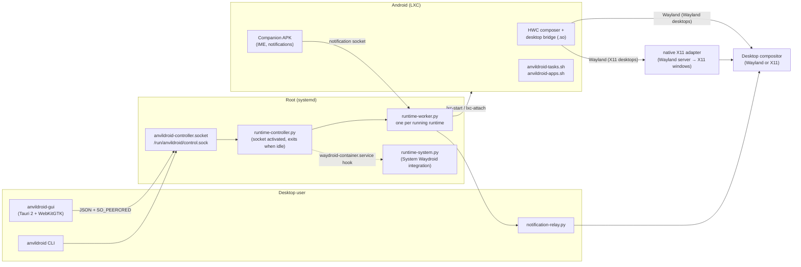
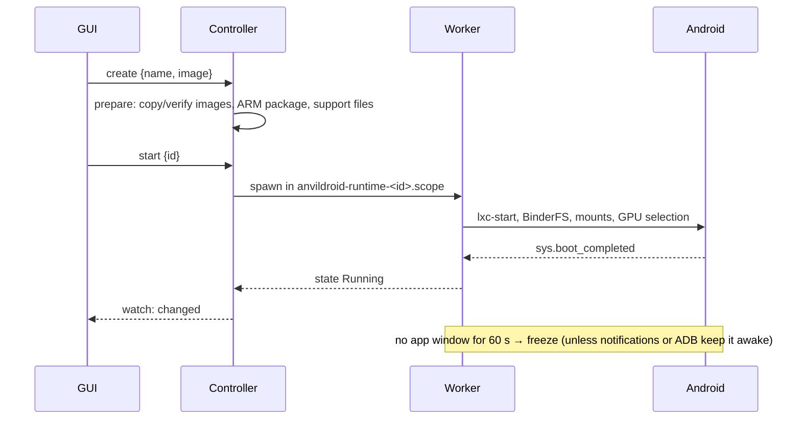
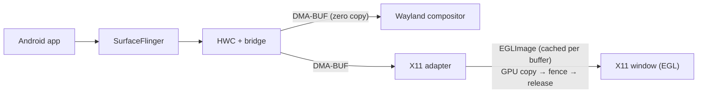
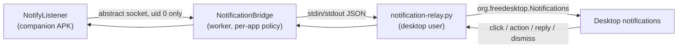
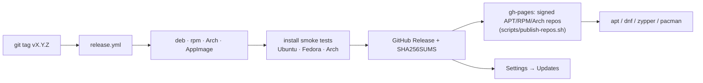

# AnvilDroid technical guide

Architecture, compatibility details, building, releasing and development.
For installation and everyday use, see the [README](../README.md).

- [Architecture](#architecture)
- [Runtime lifecycle](#runtime-lifecycle)
- [Display path](#display-path)
- [Notifications](#notifications)
- [Releases, repositories and updates](#releases-repositories-and-updates)
- [Compatibility and limitations](#compatibility-and-limitations)
- [Requirements in detail](#requirements-in-detail)
- [Building packages](#building-packages)
- [Development](#development)
- [Validation status](#validation-status)
- [ARM translation licensing](#arm-translation-licensing)

## Architecture



- **GUI and CLI** run as the desktop user. They talk only to the controller
  socket; the controller authorizes by `SO_PEERCRED` and record ownership.
- **Controller** (`services/runtime-controller.py`) owns the runtime registry,
  images, storage and jobs. systemd starts it on the first connection
  (`anvildroid-controller.socket`); it exits after 120 s with no runtime, job
  or client. The GUI follows changes through a long-poll `watch` request.
- **Workers** (`services/runtime-worker.py`) run each managed runtime in its own
  cgroup scope (`anvildroid-runtimes.slice`) with private mount/net/pid
  namespaces, BinderFS devices, resource limits and idle freezing.
- **System Waydroid** is integrated through a drop-in for
  `waydroid-container.service` (`runtime-system.py`), so the existing
  installation keeps working while AnvilDroid manages its settings.
- **Inside Android**, the desktop bridge (`native/bridge`) is loaded into the
  HWC composer; helper scripts handle task snapshots, resizes and app jobs; the
  companion APK provides the host IME bridge and the notification listener.

## Runtime lifecycle



Start-at-login runtimes are started by a hidden per-user autostart entry
(`anvildroid-gui --login-start`), because the controller only runs on demand.

## Display path



- **Wayland desktops:** Android buffers go to the compositor as DMA-BUFs; the
  bridge only adds window geometry, CSD and input. Viewport state is sent only
  when it changes.
- **X11 desktops:** the adapter (`native/x11`) imports each guest DMA-BUF once,
  copies frames on the GPU into recycled textures and releases the guest buffer
  when a native fence signals (`x11_adapter_release=fence`), so its event loop
  never blocks in `glFinish`. Details: [native/x11/README.md](../native/x11/README.md).
- **NVIDIA:** the Venus path copies on the GPU into a three-slot ring.
  See [native/nvidia/README.md](../native/nvidia/README.md).
- The task helper snapshots Android windows every 250 ms while they change and
  every 1 s when stable; resizes, closes, launches and new surfaces wake it.

## Notifications



The worker enters the runtime's network namespace, authenticates the companion
by its UID, applies the per-runtime and per-app policy, rate-limits updates and
keeps Android awake while notifications are enabled. The relay runs as the
desktop user on a pinned session bus and supports actions, inline replies (KDE)
and two-way dismissal.

## Releases, repositories and updates



Push a tag matching the workspace version (update `Cargo.toml` and refresh
`Cargo.lock` first):

```bash
release_version=$(python3 scripts/release-version.py)
git tag -a "v${release_version}" -m "Release ${release_version}"
git push origin main
git push origin "v${release_version}"
```

Supported versions: `X.Y.Z`, `X.Y.Z-alpha.N`, `X.Y.Z-beta.N` and `X.Y.Z-rc.N`.
The workflow (`.github/workflows/release.yml`) builds and verifies each package
format, builds the AppImage with pinned, checksummed linuxdeploy tools, tests
installation, controller IPC, CLI and GUI rendering in containers, and only then
creates the release. `workflow_dispatch` validates packages without publishing.

- **Repositories:** stable tags publish signed APT, RPM and Arch repositories
  to GitHub Pages (same layout as skey). This needs the `APT_GPG_PRIVATE_KEY`
  and `APT_GPG_KEY_EMAIL` secrets and Pages serving `gh-pages`; without them
  the release still succeeds and only the repositories are skipped.
  Prereleases are never published to the repositories. Each repository keeps
  the three newest versions.
- **In-app updates:** Settings → Updates checks GitHub Releases (also quietly
  once a day), downloads the asset matching the installation type (.deb, .rpm,
  Arch package or AppImage) through the GitHub API, verifies it against the
  release's `SHA256SUMS`, installs it through pkexec (an AppImage is replaced
  in place) and offers a restart.
- **NVIDIA payload:** CI downloads the pinned NVIDIA artifacts. If the default
  token cannot read them, configure `NVIDIA_ARTIFACT_TOKEN` with Actions read
  access to `collyn/waydroid-nvidia`. Those artifacts expire; keep verified
  archives for reproducible builds.

## Compatibility and limitations

- Official Android 13 Waydroid images are the main validated path. Custom x86_64
  images require Android SDK 33+ and compatible Waydroid components; newer
  Android builds remain experimental, especially for desktop controls and ARM
  translation.
- Full Android UI and separate app windows are exclusive within one runtime.
  Opening the full UI closes its app tasks; closing it restores the previous
  display mode without reopening them. Other runtimes can use different modes.
- **Window sizing:** app windows and Full UI offer **Menu → Size** presets and
  **Landscape / Portrait**. **Custom** follows the window size and updates
  Android after a resize finishes; Full UI fits the canvas reserved at startup,
  which covers both preset orientations. **Resize app layout** changes Android
  task bounds; **Keep resolution** keeps the Android rendering resolution.
  Images that ignore the scaling setting can soften smaller presets.
- **NVIDIA/Venus** requires an Android 13 image, driver 535+,
  `nvidia-drm.modeset=1`, desktop-user access to `/dev/udmabuf`, exactly one
  NVIDIA GPU and the matching Vulkan ICD.
- ARM translation and game support depend on the image, translator and graphics
  backend. Broad gameplay, mixed-DPI and endurance testing remain incomplete.
  FPS mouse capture depends on compositor support.
- Android's system server shares host UID 1000's inotify quota (no user
  namespace). If a desktop program exhausts `fs.inotify.max_user_watches`,
  Android cannot boot; Setup reports the program and the fix
  (`sudo sysctl fs.inotify.max_user_watches=524288`).
- The CLI is a smaller interface than the GUI; most commands target System
  Waydroid. Managed runtimes support `status`, `start`, `stop`, `apps`,
  `install`, `health` and `run` through `anvildroid --runtime ID …`.

## Requirements in detail

- Linux x86_64 with Wayland or X11. Automatic mode uses the native X11 adapter
  on Xorg and the Wayland backend on Wayland. Weston, the legacy X11 backend and
  headless mode are no longer supported; saved settings migrate automatically.
  Starting Android requires a graphical session; preparing images does not.
- Native X11 supports SDK 33-36 images that expose Waydroid's per-app composer
  with Mesa guest rendering (NVIDIA/Venus guest rendering needs SDK 33). See
  [native X11 requirements](../native/x11/README.md).
- LXC, Binder/BinderFS, namespaces and cgroups. Waydroid is optional: managed
  runtimes prefer an installed Waydroid package's LXC templates and otherwise use
  the copy bundled with AnvilDroid (GPL-3.0, see `native/lxc-templates/NOTICE.txt`),
  so they need neither the package nor an initialized System Waydroid. Only the
  System Waydroid device needs Waydroid installed and initialized.
- SELinux hosts (Fedora, RHEL, openSUSE): the package loads a small `anvildroid`
  policy module that lets Android's service managers own their private Binder
  context (`scripts/install-runtime-selinux.py`). Hosts whose LXC is built
  without AppArmor get configs without `lxc.apparmor.*` keys.
- Python 3.11+, systemd, polkit (pkexec) and the libraries declared by the
  package (WebKitGTK 4.1, GTK3, GLib, Soup 3, Pango, Cairo, GDK Pixbuf).
  Packages bundle private AOSP `aapt`/`apksigner` and depend on a headless Java
  runtime for image preparation. The panel icon needs an AppIndicator library
  such as `libayatana-appindicator3-1`.
- Releases build on Ubuntu 24.04; packages require glibc 2.39 or newer.

## Building packages

These steps target **Ubuntu 24.04 x86_64**, matching CI. Run builds as your
normal user from the repository root; allow several GB of free space. Building
does not need a running Android runtime or a Binder-enabled kernel.

### 1. Host dependencies and source

```bash
sudo apt-get update
sudo apt-get install -y --no-install-recommends \
  git curl ca-certificates unzip patch e2fsprogs build-essential pkg-config \
  clang lld openjdk-17-jdk-headless aapt apksigner patchelf \
  libgtk-3-dev libwebkit2gtk-4.1-dev librsvg2-dev libssl-dev \
  libwayland-dev wayland-protocols libegl1-mesa-dev libgles2-mesa-dev \
  libx11-dev libxcursor-dev libxkbcommon-dev libxi-dev libxfixes-dev \
  libxext-dev libxtst-dev libgl1-mesa-dri libgbm1 libvulkan1 \
  libayatana-appindicator3-1 dpkg-dev rpm zstd cpio gh

git clone https://github.com/anvildroid/anvildroid.git
cd anvildroid
rustup toolchain install stable --profile minimal
rustup default stable
rustup component add clippy rustfmt
```

The GUI embeds its HTML/CSS/JavaScript; no `npm install` or bundler is needed.
Node.js 22 runs the optional frontend tests.

### 2. Android SDK

Install the [Android command-line tools](https://developer.android.com/studio#command-tools)
or reuse Android Studio's SDK, then:

```bash
export JAVA_HOME=/usr/lib/jvm/java-17-openjdk-amd64
export ANDROID_HOME="$HOME/Android/Sdk"
export PATH="$JAVA_HOME/bin:$ANDROID_HOME/cmdline-tools/latest/bin:$ANDROID_HOME/platform-tools:$PATH"

sdkmanager --sdk_root="$ANDROID_HOME" --licenses
sdkmanager --sdk_root="$ANDROID_HOME" \
  "platform-tools" "platforms;android-23" "platforms;android-35" "build-tools;35.0.0"

sudo mkdir -p /usr/lib/android-sdk/platforms/android-23
sudo ln -sf "$ANDROID_HOME/platforms/android-23/android.jar" \
  /usr/lib/android-sdk/platforms/android-23/android.jar

sh scripts/stage-image-tools.sh --check
```

The API 23 path is fixed in the Android helper build scripts. API 35 and
build-tools 35.0.0 are needed for the patched scrcpy server and image tools.
No AOSP build or NDK is required.

### 3. Pinned build inputs

```bash
sh scripts/prepare-ci-inputs.sh
sh scripts/prepare-scrcpy.sh
gh auth login
python3 scripts/prepare-nvidia-fork.py --download
```

`prepare-ci-inputs.sh` fetches the pinned R8 jar and extracts `init.waydroid.rc`
and `framework-res.apk` from a pinned Android 13 image. `prepare-scrcpy.sh`
builds the patched control server. All package formats bundle the NVIDIA
payload; downloading its artifacts needs authenticated access to
`collyn/waydroid-nvidia`. Keep `target/tools/nvidia/` for reuse.

### 4. Build and verify

```bash
./scripts/build-deb.sh   # Debian/Ubuntu
./scripts/build-rpm.sh   # Fedora/RPM
./scripts/build-pkg.sh   # Arch Linux
sh scripts/package-appimage.sh "$(python3 scripts/release-version.py)"   # AppImage (needs linuxdeploy)
```

Outputs (versions from `scripts/release-version.py`):

```text
target/releases/anvildroid-controller_<DEBIAN_VERSION>_amd64.deb
target/releases/anvildroid-controller-<RPM_VERSION>-1.x86_64.rpm
target/releases/anvildroid-controller-<VERSION>-1-x86_64.pkg.tar.zst
target/releases/<VERSION>/AnvilDroid-<VERSION>-x86_64.AppImage
```

The native X11 adapter is built locally from the development libraries above;
CI can supply a verified payload with `ANVILDROID_X11_PAYLOAD=/abs/path`. For
the Ubuntu 24.04 glibc baseline, build it in a 24.04 container
(`python3 native/x11/build-host.py`). Verify a package before installing:

```bash
deb_version=$(python3 scripts/release-version.py --debian)
python3 scripts/verify-package.py "target/releases/anvildroid-controller_${deb_version}_amd64.deb"
sudo apt install "./target/releases/anvildroid-controller_${deb_version}_amd64.deb"
```

| Error | Resolution |
| --- | --- |
| Missing `target/tools/r8-8.3.37.jar` or `Touch Probe build failed` | Run `sh scripts/prepare-ci-inputs.sh` first. |
| Missing API 23 `android.jar` | Install `platforms;android-23` and create the symlink in step 2. |
| Missing scrcpy or image-tool inputs | Install API 35 and build-tools 35.0.0, export `ANDROID_HOME`, rerun the preparation. |
| `pkg-config` cannot find GTK, WebKitGTK, Wayland or X11 | Install the development packages in step 1. |
| NVIDIA artifact download returns 403/404/410 | Check GitHub authentication and artifact access; expired artifacts need cached verified inputs. |

## Development

```bash
cargo check --workspace --locked
cargo test --workspace --locked
cargo clippy --workspace --all-targets --locked -- -D warnings
node --test tests/*.cjs                 # GUI/frontend
sh scripts/test-runtime-features.sh     # backend, frontend and native feature checks
sh native/bridge/test-window-state.sh   # native bridge window state
sh native/bridge/test-android-window.sh # bridge window lifecycle (--live uses your compositor)
python3 native/x11/build-host.py        # build the X11 adapter test binaries
python3 native/x11/host-check.py        # X11 adapter (add --software-x11 for Xvfb)
```

`sh scripts/build-runtime.sh` builds the whole runtime payload without
packaging. For CLI/core-only work, Android inputs and GUI libraries are not
needed: `cargo test --locked -p anvildroid-core -p anvildroid-cli`.

Main directories: `crates/` (Rust GUI, core, CLI), `services/` (controller,
workers, notifications), `native/` (bridge, X11 adapter, IME, input, HWC,
NVIDIA), `scripts/` (build, release, repositories) and `packaging/` (package
staging, systemd units, AppImage, NVIDIA assets). Native notes are in [native/hwc](../native/hwc/README.md),
[native/x11](../native/x11/README.md) and [native/nvidia](../native/nvidia/README.md).

Some checks use Unix sockets and ownership checks that restricted sandboxes
block; run them in a normal user shell.

## Validation status

Live checks have covered official Android 13 images, concurrent runtime
isolation, app management, full Android UI open/close recovery, shutdown data
persistence, native X11 windows on Cinnamon (Intel), notification mirroring and
socket-activated controller lifecycle. NVIDIA/Venus is integrated as an
experimental backend with a pinned, verified payload. Compatibility across
custom images, desktops and games is still being developed.

## ARM translation licensing

AnvilDroid's MIT license covers its own source code. The translators are
proprietary Google/Intel prebuilts obtained from community mirrors:

| Component | Source / origin | License information in the pinned archives |
| --- | --- | --- |
| Google's `libndk_translation` | [supremegamers NDK prebuilts](https://github.com/supremegamers/vendor_google_proprietary_ndk_translation-prebuilt); ChromeOS Zork/Guybrush | All three checked revisions include [ARM_TO_AMD_DBT_LICENSE.txt](../packaging/arm/ARM_TO_AMD_DBT_LICENSE.txt), a limited grant concerning ARM ISA copyrights. |
| Intel's `libhoudini` | [supremegamers Houdini prebuilts](https://github.com/supremegamers/vendor_intel_proprietary_houdini); ChromeOS, Microsoft WSA and Google Play Games for PC | No standalone license notice or redistribution grant was found in the seven checked revisions; their `Android.mk` files mark the modules proprietary. |

The NDK notice names `system/lib/libndk_translation.so` and
`system/lib64/libndk_translation.so`. It covers only ARM's copyright in the
ARM-v8/ARM-v9 ISAs, requires keeping its notices and disclaimer, excludes other
rights including patents, and (clause 3) permits redistribution only with the
sale of a semiconductor product containing an AMD-64 compliant core licensed or
sold by AMD. Read the [complete notice](../packaging/arm/ARM_TO_AMD_DBT_LICENSE.txt)
and its [pinned upstream copy](https://github.com/supremegamers/vendor_google_proprietary_ndk_translation-prebuilt/blob/68734c52556d3d7a6db34c603dd9276915c29f2f/ARM_TO_AMD_DBT_LICENSE.txt).

For Houdini, redistribution permission has not been established from those
archives. Public availability and SHA-256 verification do not grant
distribution or modification rights; check the rightsholder's terms before
redistributing translator binaries, modified variants or images containing them.

Packages include only the catalog/downloader code; translator archives are
fetched during runtime preparation or version installation. Revisions, patch
variants, URLs and checksums are listed in
[the catalog](../services/runtime-arm-source.py).
