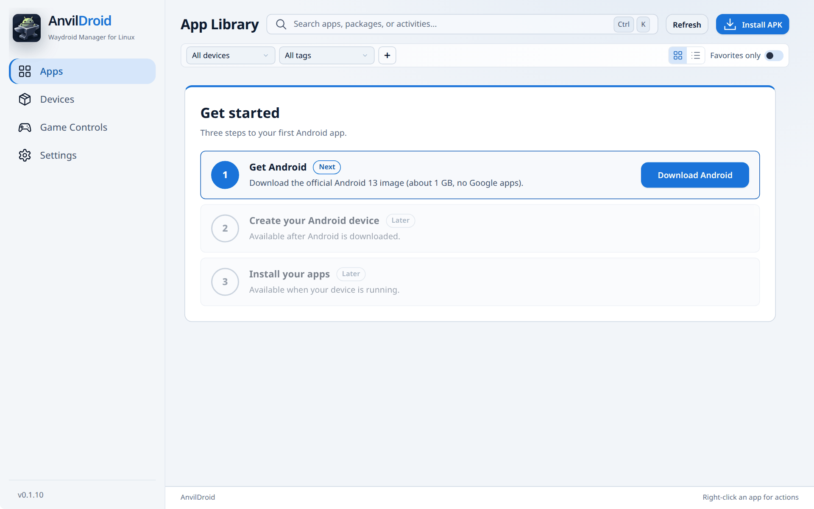
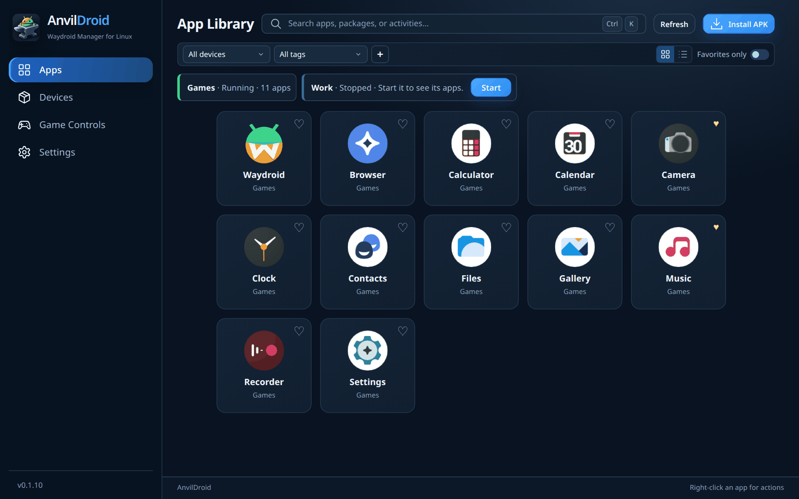
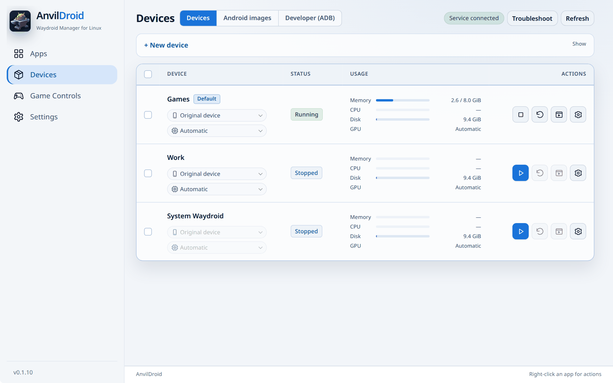
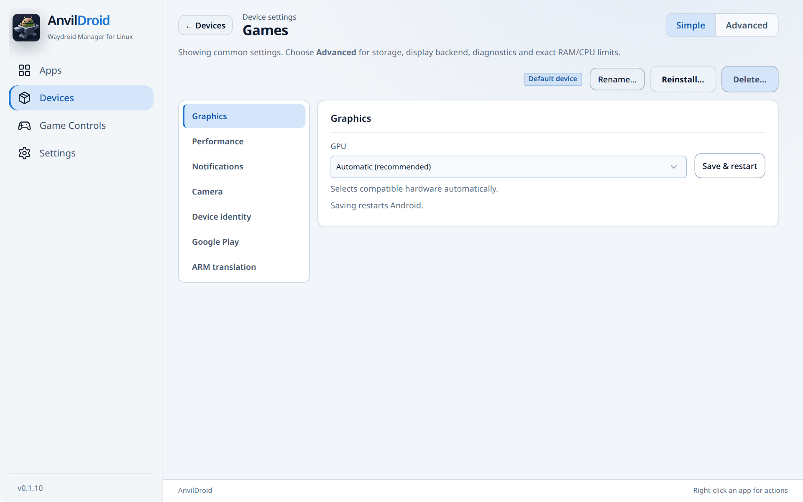
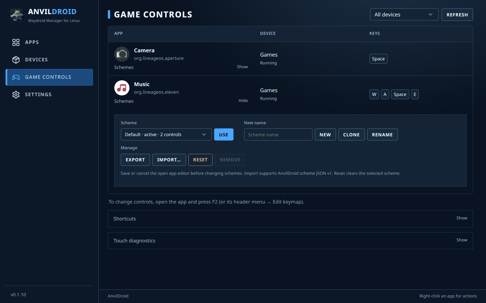
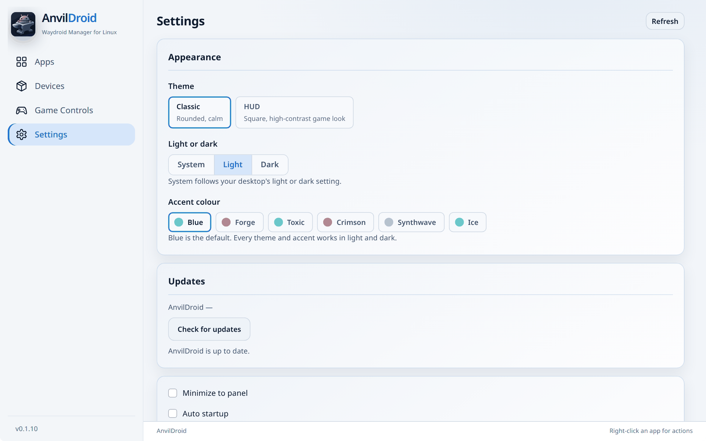
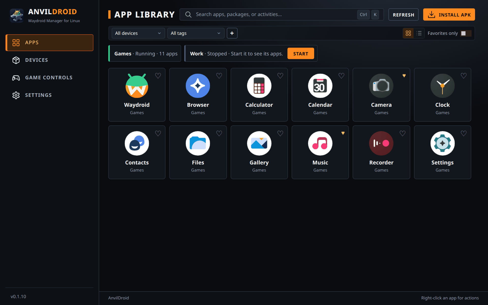

# AnvilDroid user guide

How to use AnvilDroid day to day: set up Android, manage devices, run apps,
map game controls and adjust the app. For installation see the
[README](../README.md#install); for internals see the
[technical guide](TECHNICAL.md).

The sidebar has four pages: **Apps**, **Devices**, **Game Controls** and
**Settings**. A *device* is one isolated Android system (a Waydroid runtime)
with its own apps, data and settings. You can run several side by side.

- [First start](#first-start)
- [Apps](#apps)
- [Devices](#devices)
- [Android images](#android-images)
- [Device settings](#device-settings)
- [Game controls](#game-controls)
- [Developer (ADB)](#developer-adb)
- [Settings: themes, updates, startup](#settings)
- [Troubleshooting](#troubleshooting)

## First start

When no device exists yet, the **Apps** page shows **Get started** with three
steps:

1. **Get Android** downloads and verifies the official Android 13 image
   (about 1 GB, no Google apps). If the Waydroid tools are missing, this step
   offers **Open setup** instead, which installs them.
2. **Create and start** makes a device called "My Android" and boots it. The
   first start takes a few minutes while the image is prepared.
3. **Install APK** becomes available once the device is running.

You can keep using the app while a step runs. If you already use Waydroid,
AnvilDroid shows it as **System Waydroid** and skips this guide.

## Apps

- **Open an app:** click it. Each Android app opens in its own desktop window.
  The **Waydroid** tile opens the full Android UI of that device instead.
- **Install an APK:** **Install APK**, choose the file, then pick one or more
  running devices to install it on.
- **Device chips** above the grid show every device with its state and app
  count. A stopped device has a **Start** button right there.
- **Find apps:** search with <kbd>Ctrl</kbd>+<kbd>K</kbd>, filter by device or
  tag, or turn on **Favorites only**. Click the heart on a tile to favorite it.
  The **+** button next to the tag filter creates and manages tags.
- **Grid or list:** switch with the two buttons on the right of the filter bar.
  When apps from several devices are shown, they are grouped per device.
- **Right-click an app** for more: App details, Android App Info,
  Compatibility… (per-app *Fake Wi-Fi* and *Mouse as touch*), Force-stop…,
  Create/update menu shortcut, Uninstall….

Only apps from running devices are listed. New apps get a menu shortcut in your
desktop's application menu automatically (you can turn this off in Settings).

## Devices

**Devices** has three tabs: **Devices**, **Android images** and
**Developer (ADB)**.

- **Create a device:** open **+ New device**, enter a name, choose an image and
  click **Create device**. You need an image first; see
  [Android images](#android-images).
- **Row actions:** Start / Stop, Restart, **Open Waydroid** (full Android UI)
  and **Settings**. Tick several rows to start, stop or restart them together.
- **Quick switches:** the two menus under each name change the device identity
  (e.g. Pixel 8 Pro) and the GPU. A running device restarts to apply them.
- **Usage** shows memory, CPU, disk and GPU while a device runs.
- The **Default** tag marks the device that opens when nothing else is chosen.
  Change it in the device's settings (**Set as default**).
- **Troubleshoot** shows setup checks and **Restart controller**.

## Android images

The **Android images** tab lists the images you can create devices from.

- **Official images:** download the Waydroid VANILLA image (no Google apps) or
  GAPPS (with Google Play). Downloads are verified before use.
- **Import custom image…:** use your own `system.img` and `vendor.img` from a
  folder, a ZIP file or a URL. ext4, EROFS and SquashFS images work; custom
  images are experimental.
- **Create device** starts a new device from an image. **Reinstall** replaces
  the Android system of a stopped device; it erases that device's apps and data.

## Device settings

Open a device's **Settings** from the Devices page. Pick a category on the
left; **Simple** shows the common ones, **Advanced** adds storage, display
backend, diagnostics and exact RAM/CPU limits. The buttons on top set the
default device, rename, reinstall or delete it (stop it before deleting).

| Category | What it does |
|---|---|
| Graphics | Choose the GPU, or Automatic. Saving restarts Android. |
| Display | Desktop windows (one window per app) or the full Android UI. Only one mode at a time. |
| Performance | RAM and CPU limits, with presets from Light to Unlimited. |
| Notifications | Show Android notifications on the desktop; turn them off per app. |
| Camera | Pass one or more of this computer's cameras to Android. |
| Device identity | Spoof the Android device model (Pixel, Galaxy, ROG Phone…). Some apps behave differently per model. |
| Google Play | Help with Play Protect registration on GAPPS images. |
| ARM translation | Install libndk_translation or libhoudini to run ARM-only apps. |
| Storage (Advanced) | Where the device's data lives, moving it to another disk, and **Shared folders** from your home that appear under `/sdcard/AnvilDroid`. |
| Managed copy (Advanced) | Import System Waydroid's apps and data into a separate device. |
| Diagnostics (Advanced) | Session details and **Export report** (a JSON file for bug reports). |

Settings marked to apply on restart take effect the next time the device
starts.

## Game controls

Map keyboard and mouse to touch in any Android app or game.

1. Open the app, then press <kbd>F2</kbd> (or the window's header menu →
   **Edit keymap**). An overlay editor opens on top of the app.
2. Add controls where the game expects touches: tap, hold, joystick (WASD),
   swipe, repeat, skill, macro, aim, mouse-to-touch and FPS mouse look.
3. Save. The controls work whenever that app has focus.

| Key | Action |
|---|---|
| <kbd>F2</kbd> | Edit keymap |
| <kbd>F3</kbd> | Turn the controls on or off (e.g. to type in chat) |
| <kbd>F4</kbd> | Show or hide the control markers |
| <kbd>Esc</kbd> | Cancel editing |

The **Game Controls** page lists every app with saved controls, per device.
Open **Schemes** under an app to keep several layouts:

- **Use** makes the selected scheme active.
- **New**, **Clone** and **Rename** take the name typed in **New name**.
- **Export** saves a scheme as an AnvilDroid JSON file; **Import…** loads one.
- **Reset** clears the selected scheme. **Remove** deletes a custom scheme that
  is not active (Default cannot be removed).

Save or cancel the editor in the app window before changing schemes.
**Touch diagnostics** installs a small probe app to check that touches arrive.

## Developer (ADB)

The **Developer (ADB)** tab connects a running device to ADB so Android Studio
can see it. Click **Connect** for a device, then select it in Android Studio and
approve USB debugging in Android if asked. Under **Android SDK** you can point
to the same `adb` that Android Studio uses. Connections stay on this computer
and end when the device or controller stops.

## Settings

- **Theme:** **Classic** (rounded, calm) or **HUD** (square, high-contrast game
  look). Both have the same pages and controls.
- **Light or dark:** System follows your desktop, or pick one.
- **Accent colour:** Blue, Forge, Toxic, Crimson, Synthwave or Ice.
- **Updates:** **Check for updates** downloads the right package for your
  system after you confirm, then restarts AnvilDroid. If you installed from the
  package repository, normal system updates work too.
- **Minimize to panel, Auto startup, Startup minimize** and automatic menu
  shortcuts for new apps.
- **Start at login:** choose which devices start when you log in.

## Troubleshooting

- **A device does not start:** open **Devices → Troubleshoot** to see what is
  missing; **Restart controller** if the service looks stuck.
- **An app misbehaves:** right-click it → **Force-stop…** and open it again.
  Apps that need Wi-Fi or treat the mouse oddly can be adjusted under
  **Compatibility…**.
- **Report a bug:** device **Settings → Diagnostics → Export report**
  (Advanced view) and attach the file to a
  [GitHub issue](https://github.com/anvildroid/anvildroid/issues).
- More on limits (Play Integrity, NVIDIA, image support):
  [compatibility and limitations](TECHNICAL.md#compatibility-and-limitations).
