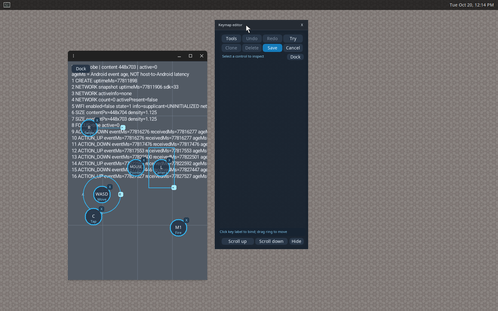

# GPU keymap acceptance, 2026-10-20

Candidate: `0.1.3+keymap.v4.8`; embedded GUI/CLI: `0.1.3`.
These are copies of actual opt-in acceptance output in
`target/keymap-redesign/`. No original summary result rows were edited.
Runtime generations, package SHA-256 and the live bridge hash bind the
controls, game, GPU and cleanup evidence to this candidate.

| Check | Native X11 | Nested Wayland |
| --- | --- | --- |
| Input/editor/lifecycle/schemes/detached/capture | 73/73 | 73/73 |
| Visible app-content checks | 22 | 22 |
| Luanti 5.17.0 + Minetest Game 5.8.0 | 11/11 | 11/11 |
| Captured game camera | 30.2082 seconds | 30.1909 seconds |
| Stop/cleanup/quiescence audit | Pass | Pass |

Actual Wayland detached panel after its header drag:

For each backend:

- `*-controls.json` and `*-game.json` retain the original measured scenarios.
- `*-gpu.json` records direct accelerated RX 6600 desktop GLX, actual Android
  GLES radeonsi/navi23 and SurfaceFlinger's open `/dev/dri/renderD128`. It also
  records the native X11 GPU presenter or inner Wayland hardware renderer.
- `*-game-gpu.json` records the live Luanti process's AMD DRM graphics engine
  counters, proving GPU submissions from the game, and its native bridge hash.
- `*-cleanup.json` requires Stopped, cleanup complete, quiescent, and no owned
  processes, scope tasks, loop devices or host mounts.
- `*-detached.png` and `*-detached-geometry.json` show the panel actually dragged
  outside Android while its canvas remains unchanged. Wayland uses Weston
  compositor moves. The private X11 display has no WM and uses an exact-window
  EWMH move fixture; it is not an installed KDE acceptance run.

`checks.json` records maintained regressions, package checks/hashes and bridge
provenance. [Implementation and reproduced failures](../../KEYMAP-REDESIGN-IMPLEMENTATION.md)
and [reproduction instructions](../../../tests/acceptance/README.md) explain
how these results were obtained. The earlier `.v4.7` X11 result is retained
[separately](../keymap-v4.7/README.md), including its historical transport-label
reporting bug. Final `.v4.8` summaries copy the actual transport metadata.

## Scope

The Android guest, private GPU desktop and production bridge/scrcpy input
path are real. XTest injects through authenticated private displays. The
selected GPU is AMD Radeon RX 6600, PCI `0000:08:00.0`; host Mesa overrides
are restricted to fixture processes. Software renderer names fail the gate.
The editor draws SHM buffers which the hardware compositor composites; these
results establish hardware Android/game/display rendering, not GPU execution
of every CPU-side UI or test operation.

Personal runtimes, physical input devices, desktop DBus/audio and installed
services are not used. No package was installed on the host during this
acceptance. Results do not certify physical mouse feel, ordinary KWin/GNOME
or CachyOS window behavior, NVIDIA/Intel GPUs, commercial FPS/MOBA/ARM games,
latency, performance or long sessions. Full raw stage logs and failed attempts
remain in the local `target/keymap-redesign/` tree. AppImage is deferred.
